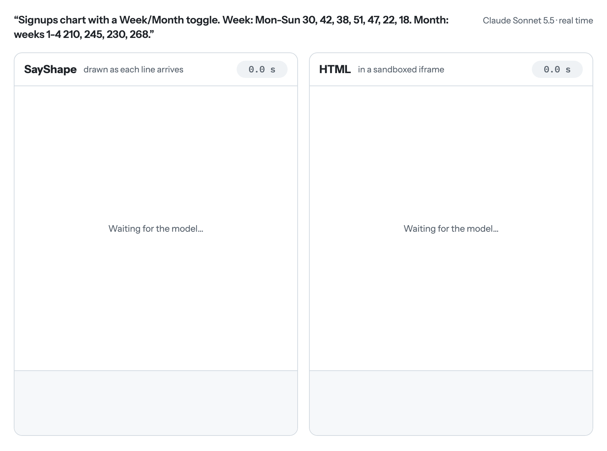
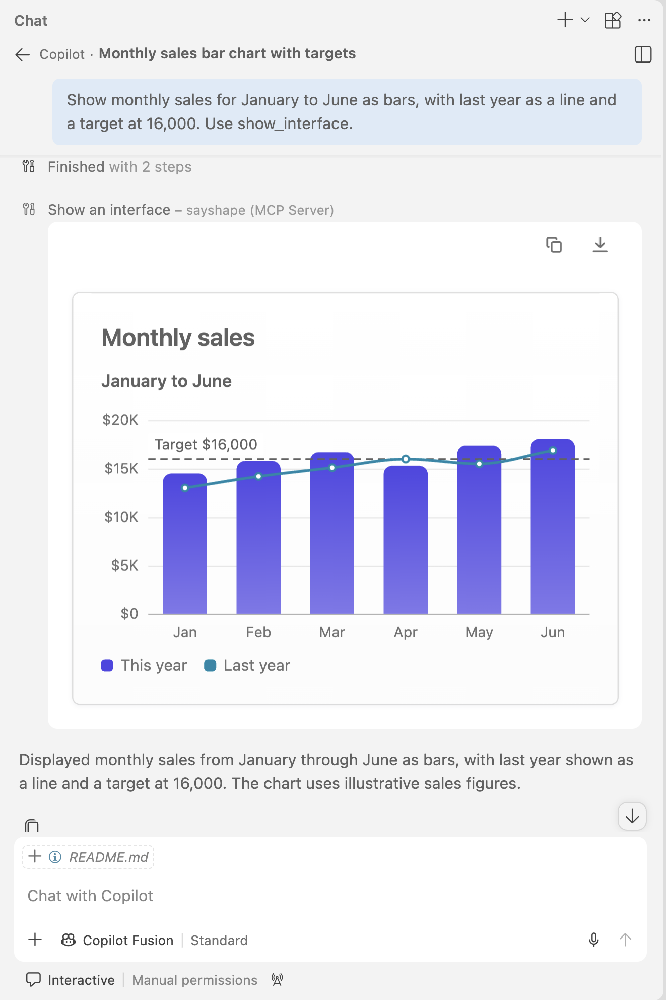
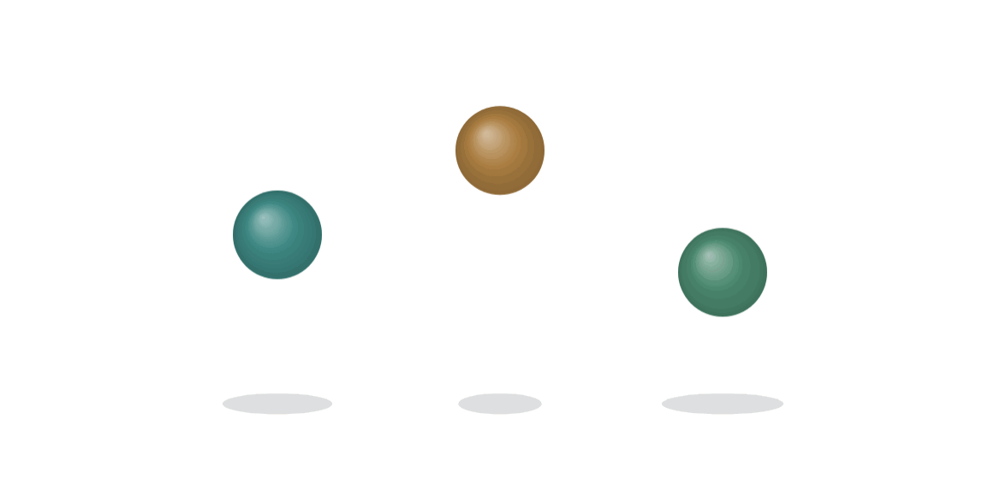
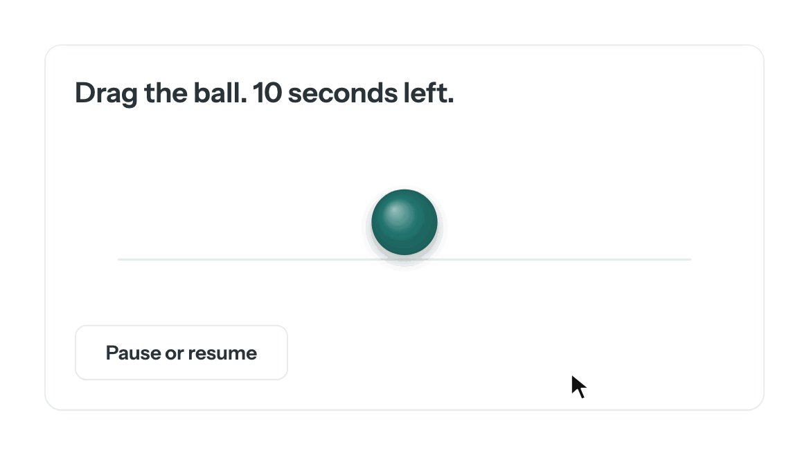

<h1 align="center">SayShape</h1>

<p align="center"><b>The UI language AI models write, and the engine that draws it.</b><br>
A model streams a few lines. A working interface appears while it is still writing.<br>
Nothing the model writes is ever run as code.</p>

<p align="center">
  <a href="https://www.npmjs.com/package/sayshape"></a>
  <a href="https://github.com/premmannava/sayshape/actions/workflows/ci.yml"></a>
  <a href="LICENSE"></a>
  
</p>

<p align="center">
<picture>
  <source media="(prefers-color-scheme: dark)" srcset="docs/images/hero-dark.gif">
  
</picture>
</p>

<p align="center">
  <b><a href="https://premmannava.github.io/sayshape/playground">Playground</a></b> ·
  <b><a href="https://premmannava.github.io/sayshape/examples/">Examples</a></b> ·
  <b><a href="https://premmannava.github.io/sayshape/compare">Watch the formats race</a></b> ·
  <b><a href="https://premmannava.github.io/sayshape/docs/">Docs</a></b> ·
  <b><a href="https://premmannava.github.io/sayshape/docs/integration/mcp">Use it in Claude or ChatGPT</a></b>
</p>

The picture is one request, answered by the same model in two formats and replayed in real time. The SayShape answer is a working chart after 2.2 seconds and 616 characters. The HTML answer takes 11.8 seconds and 5,196 characters.

## Why not let the model write HTML?

Models can write good HTML. SayShape takes a different route: rendering, styling, interactions and validation are built into the engine, so the model only has to describe the interface. Your theme decides how it looks, and the engine decides how it behaves.

| | Model-generated HTML/CSS/JavaScript | SayShape |
|---|---|---|
| **Execution** | Generated JavaScript needs controlled execution or a sandbox. | Specs describe UI through supported elements, expressions and actions. They can't run arbitrary JavaScript, images load only from hosts you allow, and links are handed to your app, never opened. |
| **Design consistency** | Consistency depends on the styling instructions and on what each answer generates. | Standard elements use your theme automatically. The model picks semantic roles such as `style=title`. |
| **Generation size** | The model may need to write markup, styles and interaction code. | Rendering and interactions are built in, so the model describes the interface in a compact spec. |
| **Error handling** | Validation and recovery depend on the host integration. | Built-in validation reports problems with their line numbers and how to fix them, skips what is invalid and draws the rest, so the model can correct itself. |
| **Streaming** | HTML can render progressively; interactivity depends on when the scripts and handlers it needs are ready. | Each complete, valid line can draw during generation, with its interactions already implemented by the engine. |

## What a model writes

This is the whole SayShape answer from the picture above, exactly as the model wrote it:

```
state view="Week" week=[{label: "Mon", signups: 30}, {label: "Tue", signups: 42}, {label: "Wed", signups: 38}, {label: "Thu", signups: 51}, {label: "Fri", signups: 47}, {label: "Sat", signups: 22}, {label: "Sun", signups: 18}] month=[{label: "Week 1", signups: 210}, {label: "Week 2", signups: 245}, {label: "Week 3", signups: 230}, {label: "Week 4", signups: 268}]
derive shown={view == 'Week' ? week : month}
card
  text "Signups" style=title
  segmented bind=view options="Week,Month"
  stat label="Total signups" value={number(sum(shown, 'signups'))}
  chart kind=bar items=shown x=label y=signups format=number
```

- **One element per line, indentation for nesting.** Every finished line can be drawn at once, and a half-finished answer is still a valid, smaller screen.
- **State and values worked out from it.** `state` holds the data, `derive` keeps a value up to date, `bind=` connects a control to state, and `{…}` reads it. Pressing Month changes `view`; the total and the chart follow.
- **No colors, fonts or pixel sizes.** The model picks roles such as `style=title`. The engine and your theme decide how they look, so every screen matches.
- **No code.** `{…}` can read state, do arithmetic and call a fixed list of functions. There is no route from a spec to JavaScript, so there is nothing to sandbox.

## Try it

**In the browser, nothing to install.** Open the [playground](https://premmannava.github.io/sayshape/playground), edit a spec and watch the screen change, or browse the [examples](https://premmannava.github.io/sayshape/examples/).

**In Claude, ChatGPT, VS Code or another chat app.** SayShape is an [MCP Apps](https://modelcontextprotocol.io/docs/extensions/apps) server: ask for a chart, a table or a calculator and the assistant answers with a working one inside the conversation. The setup for each app is in [`mcp/README.md`](mcp/README.md).

```bash
npx -y sayshape-mcp
```

<p align="center">
<picture>
  <source media="(prefers-color-scheme: dark)" srcset="docs/images/vscode-dark.png">
  
</picture>
<br><sub>One request in GitHub Copilot's chat in VS Code, answered with a working chart inside the conversation.</sub>
</p>

**In your own app.**

```bash
npm install sayshape
```

```ts
import { SayShape, coreComponents } from "sayshape";

const ui = new SayShape(document.querySelector("canvas")!, { components: coreComponents });

ui.setSpec(`
state count=0
card
  text "Pressed {count} times"
  button "Press me" on=inc:count
  button "Save" variant=secondary on=emit:save:{count}
`);

// The only thing that leaves a screen: an action your app chose to listen for.
ui.on("action", ({ name, value }) => console.log(name, value));
```

To have a model write the spec, `sayshape/model` streams it from any OpenAI-compatible endpoint into `ui.push()`, checks it with the parser and asks once for a fix. See [Connecting a model](docs/model.md).

## Experimental: drawing and behavior

Two features are **experimental and off by default**. They work, they have tests, and they may still change. Turn them on only where you want them.

**Drawing (`scene`).** The model paints a picture or an animation from shapes, for what no ready-made element shows: a diagram to press, a ball that bounces, a sun that rises. Any value can be a formula of `t`, the seconds since it started. `shadow=`, `glow=` and `shine=` give shapes depth.

```
state colors=["accent", "warn", "good"]
scene "Three balls bouncing on a floor" w=600 h=260 duration=1
  each items={range(3)} as=i
    ellipse x={150 + 150*i} y=236 rx={50 - 22*abs(sin(PI*(t + i/3)))} ry=7 fill="ink 20%"
    circle x={150 + 150*i} y={204 - 140*abs(sin(PI*(t + i/3)))} r=30 fill={pick(colors, i)} shine=true
```

<picture>
  <source media="(prefers-color-scheme: dark)" srcset="docs/images/demo-draw-dark.gif">
  
</picture>

**Behavior.** A spec can change by itself and be dragged. `every` runs state changes on a timer, and `drag=true` lets people move a shape in a scene. Rules only ever write state: they still can't run code.

```
state x=300 left=10 running=true
every 1s if={running && left > 0} do=dec:left
card
  text "Drag the ball. {left} seconds left." style=title
  scene "A ball you can drag" w=600 h=160
    line x1=40 y1=118 x2=560 y2=118 stroke=line width=2
    circle x={clamp(x, 40, 560)} y=84 r=30 fill=accent shine=true shadow=md drag=true
  button "Pause or resume" variant=secondary on=toggle:running
```

<picture>
  <source media="(prefers-color-scheme: dark)" srcset="docs/images/demo-behavior-dark.gif">
  
</picture>

Both pictures are recorded from the engine running those exact specs (`npm run readme:demos`).

How to turn them on:

| Where | Drawing | Behavior |
|---|---|---|
| Chat apps (MCP server) | `npx -y sayshape-mcp --scene` | add `--behavior` |
| Your own app | `components: [...coreComponents, ...sceneComponents]`, from `sayshape/scene` | `behavior: true` in the engine's options |
| The model guide | pass the same components to `languageGuide` | `languageGuide(registry, { behavior: true })` |
| Local playground (`npm run dev`) | `?scene=1` | `?behavior=1` |

Dragging needs both, because it happens inside a scene.

```ts
import { SayShape, coreComponents } from "sayshape";
import { sceneComponents } from "sayshape/scene";

const ui = new SayShape(canvas, {
  components: [...coreComponents, ...sceneComponents],
  behavior: true,
});
```

Scenes are the one place a spec may name its own colors, because a sunset can't be drawn in brand colors. Everywhere else the theme decides. [Using the engine](docs/engine.md) has the details and the limits.

## Which models can write it

Not every model can produce a good interface as HTML: a full page of markup, styles and script is a lot to get right. SayShape asks for much less. The language is small, there is nothing to style, and the parser tells the model which line was wrong and how to fix it. That puts cards, forms, tables and charts within reach of small, fast and local models, not only the largest ones.

The experimental features ask more of a model. Drawing a scene means placing every shape, and behavior means reasoning about change over time. In our own use so far, these come out well with stronger models, such as GPT-6 Luna, Claude Haiku 5.5 and the models above them, and less reliably below that. This is what we have seen, not a measured result; score any model yourself with `npm run eval` ([Connecting a model](docs/model.md)).

## What's in it

- **64 components**, each drawn by the engine: layout, text and icons, forms (inputs, selects, a date picker, sliders, menus, dialogs), tables, and data views that would otherwise need a library each: 14 kinds of chart including sankey, treemap, heatmap and scatter, with target lines and notes on top, plus boards, org charts, flow diagrams, schedules, Gantt timelines and maps. [Browse them all](https://premmannava.github.io/sayshape/docs/components/).
- **An engine with no dependencies.** Its own parser, layout, painter and input handling on one `<canvas>`, about 170 KB gzipped. No React, no CSS layout, no build step for specs.
- **Errors that don't break the screen.** A bad line is skipped and reported with its line number and how to fix it; the rest still draws.
- **A model guide that can't go stale.** Each component is defined once, and that definition drives validation, the docs and the prompt that teaches a model the language.
- **Accessibility.** A hidden mirror gives screen readers, keyboards and phones a role, a name and a state for everything drawn.
- **Themes.** Light and dark, your own tokens in code or CSS variables, or one brand color (`--accent` on the MCP server).
- **Testing tools.** `sayshape/testing` runs the real engine in Node, so a generated screen can be pressed and checked without a browser.
- **Any model, anywhere.** It works with any OpenAI-compatible endpoint, including one on your own servers.

## Documentation

The [website](https://premmannava.github.io/sayshape/docs/) is the best place to read, because every example on it runs live. The same reference is in this repository:

| | |
|---|---|
| [The language](docs/language.md) | Elements, state, derived values, expressions, actions, lists, screens and conditions |
| [Components](docs/components.md) | Every component's props and an example, generated from the code |
| [Using the engine](docs/engine.md) | Options, methods, events, theming, accessibility and debugging |
| [Connecting a model](docs/model.md) | `sayshape/model`, the guide and its sizes, and scoring a model yourself |
| [The MCP server](mcp/README.md) | SayShape inside chat apps, and hosting it for a team |
| [Working on SayShape](docs/development.md) | Commands, tests, writing a component and the project's layout |
| [Limitations](docs/limitations.md) and [the plan](docs/PLAN.md) | What's missing today and what comes next |

## Contributing

```bash
git clone https://github.com/premmannava/sayshape.git
cd sayshape
npm install
npm run dev     # the playground, with live reload
npm test
```

[Working on SayShape](docs/development.md) has the rest. The rules that keep the project's guarantees are in [`CLAUDE.md`](CLAUDE.md), written for AI assistants and just as useful to people.

## License

[MIT](LICENSE).

Country outlines in `src/components/map/world.json` come from [Natural Earth](https://www.naturalearthdata.com/) (public domain) via [world-atlas](https://github.com/topojson/world-atlas). US state borders in `src/components/map/states.json` come from the US Census (public domain) via [us-atlas](https://github.com/topojson/us-atlas). Lakes, rivers and city names in `src/components/map/water.json` and `places.json` come from Natural Earth 1:50m (public domain). All are drawn with the Web Mercator projection.
