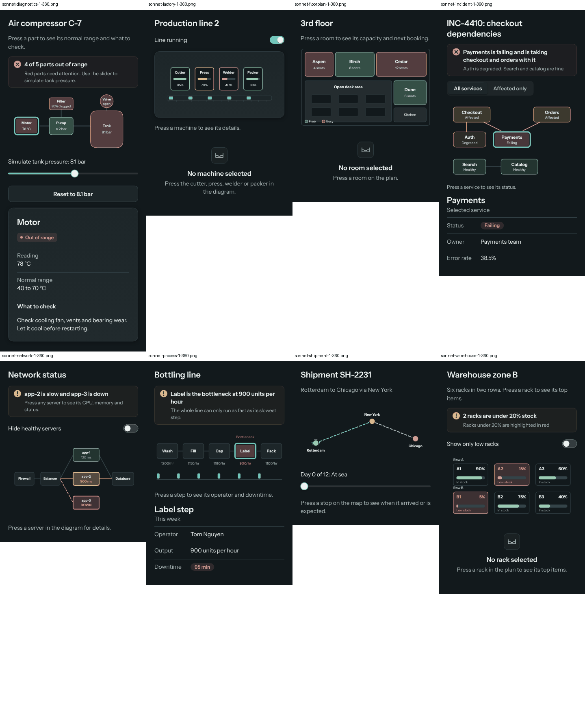

# Interactive scenes: validation report

**Date:** 2026-11-07. **Scope:** the experimental, opt-in `sayshape/scene` after interactive scenes landed ([plan](interactive-scenes.md)). **Question:** can a developer consistently get polished, responsive, accessible and correct interactive visuals from a model, without fixing them by hand?

**Short answer:** mostly correct, not yet consistently polished, and accessible to the extent automated checks can show. With a Sonnet-class model, 7 of 8 interactive scenes worked on the first try and 8 of 8 after the one automatic repair; with Haiku, 11 of 16 on the first try and 12 of 16 after repair. The usual failure is not a broken picture but no picture: the model answers with cards instead of a scene. What still needs a person: text on phones is small (readable, not comfortable), and large scenes cost many Tab presses. Screen readers were not tested by hand.

Everything below was measured, in the environments listed. Nothing is estimated unless it says so.

## Environments

| What | Where |
|---|---|
| Unit, contract and interaction tests | Node 22.23 (Linux, `vitest`), recording canvas from `sayshape/testing` |
| Browser tests and benchmarks | Google Chrome 153.0.8010.12, headless, through Playwright 1.x with the system Chrome (Playwright's own browser download is blocked here); Linux 6.18, Intel Xeon 2.30 GHz × 2 cores, 8 GB; device pixel ratio 1 |
| Models | Claude Sonnet and Claude Haiku, each run as an isolated agent that read only the generated model guide (`languageGuide` with scenes, full mode) and the request, and wrote one answer. No API endpoint was available, so the model was not called through `sayshape/model`: tokens, time to first render and total time were **not measured** (see Limitations). |
| Not tested | Safari, Firefox, real phones, VoiceOver, NVDA, TalkBack, Windows forced colors in a real browser |

## Findings

Classified before fixing. Severity: **Critical** breaks a guarantee (code runs, crash, data loss); **High** gives a wrong or silently broken interface; **Medium** degrades quality, reach or cost; **Low** is minor or affects only tooling.

No Critical findings: no spec ran code, the parser never threw, and no answer crashed the engine or logged an engine warning (56 first answers and 22 repairs, each scored with the real engine in Node and screenshotted in Chrome at 900 px in light and 360 px in dark).

| # | Severity | Finding | Evidence | Status |
|---|---|---|---|---|
| H1 | High | **`on=` on a scene shape couldn't call scene math.** `on="set:sel:{pick(steps, i).id}"` parsed with a warning ("pick works only on lines inside a scene", on a line that *is* inside one) and pressing did nothing. Every other prop on the same line (`selected=`, `tip=`, `fill=`) could call it. | A real Sonnet answer (bottling line): all five steps pressable, focusable and outlined, none of them selected anything. The eval scorer counted it as working (L1). | **Fixed.** `parseActions`, `ActionHost` and `PressContext.run` take the scene's functions; outside a scene `on=` still rejects them. 3 tests. |
| H2 | High | **A scene that uses `t` with `duration` 0 never moves, silently.** `duration` defaults to 0 (a still), and models sometimes write `t` formulas without it. Nothing warned, so a repair couldn't fix it. | 3 of 24 Sonnet answers (factory twice, network once). | **Fixed.** The drawing check warns. After the warning, the one repair made 2 of 2 move. 3 tests. |
| H3 | High | **Small-text warnings crowded out everything else.** One warning per small label, capped at 8 per answer, so contrast, overlap and straddle problems were cut from the repair request. | Baseline answers: 117 phone-text warnings against 7 of every other kind. | **Fixed.** One summary per scene, always kept, never pushing others out; contrast warnings grouped by color. 4 tests. |
| M1 | Medium | **The small-text advice made desktop worse.** It said "make its size at least N, or the scene's w smaller"; a repair shrank `w`, so the scene was blown up on desktop. | Haiku network repair. | **Fixed.** Advice says which size to use at the scene's `w`. The guide's scene example now says "at w=600, make every label size 15 or more". |
| M2 | Medium | **Models answer without a scene.** For "lay out zone B" or "draw our network", Haiku often builds a grid of pressable cards. It works, but isn't the picture asked for. | 5 of 32 baseline answers, 4 of 24 with the new guide line (3 of 16 Haiku, 0 of 8 Sonnet). A second `picks` entry ("a diagram people press parts of…") made no measurable difference. | **Not fixed.** Hosts that need a drawing can say so in their request or prompt. |
| M3 | Medium | **Scene math outside a scene had an unhelpful message.** `clamp` in `derive` got "Unknown function" with a list of functions, and the derived value silently became nothing. | A Sonnet shipment answer; its route didn't draw. | **Fixed.** The message says what to write instead (`min(max(x, low), high)`) and that `clamp` works only inside a scene. Repair fixed it. |
| M4 | Medium | **Every pressable shape is a Tab stop.** 200 machines are 200 Tab presses to get past the picture. | `bench/browser`: 200 regions → 200 focusable nodes. | **Not fixed.** Proposal below (roving focus). |
| M5 | Medium | **Text on phones is small.** A scene scales as one picture, so a label of size 15 at `w=600` is about 8 px at 360 px wide. The check's floor is 8 px, matching what the guide asks for; common guidance for body text on phones is larger. | Screenshots at 360 px. | **Not fixed.** Proposal below. |
| M6 | Medium | **Large animated scenes fill the main thread.** At 200 animated objects the main thread is busy all the time on this machine; at 500 the frame rate halves. | Performance table. | **Documented.** No change. |
| L1 | Low | The eval scorer judged a press by any change on screen, which a tip appearing on hover satisfies even when the action failed. | Found while confirming H1. | **Fixed** in `eval/scenes.ts`: a press works if it changes state or leaves that part selected. |
| L2 | Low | While pressable shapes move, the mirror is rebuilt up to 4 times a second, and screen readers hear stale positions in between. | 200 moving pressable shapes: 7,715 DOM changes in 5 s; still shapes: none. | By design; documented. |
| L3 | Low | A drawing check during animation (sampling frames) would find little. | 8 moments × 8 animated answers: 4 more warnings, all of them intended motion. | Not built (as the plan recommended). |

## Browser verification

`visual/scene.spec.ts` drives the playground's factory monitor sample in Chrome. 19 tests, all passing:

- At 1440, 1024, 768, 390 and 360 px, in Studio light and Studio dark (10 runs): every machine is a button in the scene's figure; pressing each one selects it and fills the details panel (kind, health, temperature, rate); only the selected machine reads as pressed; each machine's region is at least 24 px across; the page never scrolls sideways.
- Hover shows the tip beside the machine, above it, or below it when there's no room, inside the scene.
- Keyboard: Tab from the page enters the canvas and reaches Cutter, Press, Welder and Packer in order; Enter and Space select; the focus ring changes the pixels around the machine.
- Controls outside the scene change it with no new spec: the belt moves while the line runs and stops with the switch; dragging the slider to 150 changes the press's rate in the panel and in the mirror.
- Selection stays on the same machine when the host reorders the list (`key=`).
- Pressing works during animation, three rounds over all machines.
- Reduced motion: a still picture, and every machine still presses.
- axe finds no violations in the mirror; the figure has a name; `aria-pressed` follows the selection.
- The mirror follows shapes that appear and move during an animation.

Screenshots are attached to the test report (`npx playwright test visual/scene.spec.ts`, then the HTML report). The existing pixel baselines (`visual.spec.ts`) were not regenerated: they need the Linux Docker image this environment can't run.

## Accessibility

What the tests show: each pressable shape is a named button in a named figure, Tab order follows drawing order, Enter and Space press, the pressed state follows `selected=`, focus is drawn on the canvas and moves the DOM focus to the mirror node, reduced motion gives a still picture that works, axe-core passes on the mirror, and theme tokens meet WCAG AA contrast in light, dark and forced colors (`test/a11y/beyond.test.ts`). Label contrast inside a scene is the model's choice; the drawing check flags labels under 3:1 against what's under them, in both modes.

What is **not** shown: that a real screen reader reads it well. No screen reader was run. Before calling scenes accessible, do this by hand:

**Manual check (VoiceOver on macOS and iOS, NVDA on Windows), factory monitor sample**

1. Open the page; the screen reader says the page is busy, then "Ready".
2. Move to the picture: it's announced as a figure (VoiceOver: "group") named "Production line 2…".
3. Move inside it: four buttons, Cutter, Press, Welder, Packer, each with its tip read as the description, and Press read as pressed (selected).
4. Press Welder (VO+Space / Enter): the details panel changes to Welder and its status is readable next; Welder is now pressed, Press is not.
5. With the switch off, the belt stops; the switch is read as a switch with its state.
6. With the slider, arrow keys change the press rate and it's read out; the press's tip reads the new rate.
7. Turn on Reduce Motion: the picture is still and everything above still works.
8. iOS: swipe through the figure's buttons; double-tap selects; each button's rectangle (VoiceOver cursor) sits over its machine.
9. NVDA browse mode: the buttons are listed in the elements list (Insert+F7) under buttons.
10. Windows Contrast Themes: the page around the scene uses system colors (the scene's own colors are the model's).

**Many pressable shapes (M4).** Proposal, not built: one Tab stop per scene, arrow keys move between its pressable shapes in drawing order (Home and End to the ends), Enter and Space press. The figure keeps one mirror node per shape, so screen readers still list them all. It needs a small engine hook (`PressContext.focus(detail)`, so a component can move focus between its own parts) and a scene `key` handler; nothing in the language changes.

**Small text on phones (M5).** Proposal, not built: draw labels no smaller than about 11 px on screen, and have the drawing check report labels that would then overlap. This changes what existing scenes look like on phones, so it should be tried behind a flag first.

## Real-model evaluation

Eight requests (`eval/scenes.ts`): a factory line, a network, a shipment route, an office floor plan, warehouse racks, a process flow, an incident's dependencies and equipment diagnostics. Each asks for a picture with parts to press, a detail that follows the selection, and a control outside the picture that changes it; some ask for motion. The scorer renders each answer with the real engine and uses it: it presses every pressable part (on its shape, not just its box), Tabs through them, moves every control (sliders to 10% and 90%), and checks that state the scene reads changed.

"Works" means: no parser errors, a scene, enough pressable parts, every press changes state or selects that part, every part reachable by Tab, a control that changes the scene, motion where asked, and no engine warnings. "Clean drawing" means the drawing check found nothing.

Baseline is the guide before this work; the new guide adds the scene sizing line and the second `picks` entry. Both are scored with the current checks and scorer, so they compare.

| Model | Guide | Answers | Parses | Works first try | Clean drawing first try | Works after one repair | Answered without a scene |
|---|---|---|---|---|---|---|---|
| Sonnet | baseline | 16 | 100% | 88% (14) | 19% (3) | 88% (14) | 1 |
| Sonnet | new | 8 | 100% | 88% (7) | 50% (4) | 100% (8) | 0 |
| Haiku | baseline | 16 | 100% | 69% (11) | 25% (4) | 69% (11) | 4 |
| Haiku | new | 16 | 94% (15) | 69% (11) | 81% (13) | 75% (12) | 3 |

Repairs used the app's real repair message (`repairPrompt`, with parser and drawing-check problems). Baseline: 14 repairs, sent the warnings the check gave before this work; afterwards 13 of 14 were clean by today's check (the 14th is the `duration` problem, which the old check didn't report), and no repair broke a working answer. New guide: 8 repairs; the motion warning (H2) fixed 2 of 2, Haiku's misplaced `list-item` (a parser error) was fixed, and the one no-scene answer that got a repair stayed a card grid.

The remaining failures with the new guide: 3 Haiku answers without a scene (M2), 1 Sonnet answer that didn't move (fixed by repair), 1 Haiku parser error (fixed by repair), and 1 Haiku floor plan whose Book button sends an event to the host (`emit:book`) instead of changing the picture, which the scorer counts as a failure though a host could handle it.



*Sonnet's eight first answers with the new guide, at 360 px, dark. All work; the text inside the pictures is the size M5 is about.*

Small samples: one or two runs per request and model. Read the percentages as "most" and "some", not as rates.

### What the drawing check got right and wrong

The warnings on the 56 first answers and 22 repairs were compared with their specs and their 900 px and 360 px screenshots, every kind of warning at least once and most of them one by one.

- **True:** small phone text (real, though see M5 on how small "fine" still is), labels straddling a box's edge (a legend over the open-area outline), contrast in dark mode for hard-coded light fills under `ink`, pressable groups too small to tap, `duration` 0 with `t`.
- **False positives:** none seen in the shipped checks. The animation sampling that was tried (L3) gave only false positives, so it wasn't kept.
- **Missed:** empty space (a picture using a third of its height), and labels that are readable but tiny on phones (M5). Neither has a cheap, reliable rule yet.

## Performance

`npm run bench:scene-browser` (`bench/browser/`). A grid of groups, each a rectangle, a pulsing circle and a label, animating; "pressable" adds `on=`, `selected=` and `tip=` to every group, "moving" moves every group each frame. 5 s per run, frame times from `requestAnimationFrame` (capped by the 60 Hz display rate), paint time from the engine, main thread from Chrome's `TaskDuration`, memory from `performance.memory`.

| Objects | Pressable | Moving | Frame median / p95 / p99 (ms) | Frames > 25 ms | Paint median / p95 / p99 (ms) | Main thread busy | Hit test median / p99 (µs) | A11y tree (ms) | Mirror mutations | Resize (ms) |
|---|---|---|---|---|---|---|---|---|---|---|
| 4 | no | no | 16.7 / 16.7 / 16.8 | 0 of 300 | 0.9 / 2.3 / 2.8 | 22% | 0 / 1 | 0 | 0 | 32.3 |
| 4 | yes | no | 16.7 / 16.7 / 16.8 | 0 of 300 | 0.9 / 2.7 / 3.7 | 20% | 0.5 / 2.5 | 0 | 0 | 33.3 |
| 50 | no | no | 16.7 / 16.8 / 16.8 | 0 of 300 | 3.4 / 5.2 / 6.6 | 43% | 0 / 0.5 | 0 | 0 | 31.1 |
| 50 | yes | no | 16.7 / 16.7 / 16.8 | 0 of 300 | 4.9 / 6.6 / 7.6 | 49% | 0 / 0.5 | 0.2 | 0 | 30.3 |
| 200 | no | no | 16.7 / 16.8 / 33.4 | 12 of 289 | 11.1 / 17.8 / 22.6 | 100% | 0 / 0 | 0 | 0 | 52.3 |
| 200 | yes | no | 16.7 / 33.4 / 33.4 | 42 of 259 | 12.3 / 20.6 / 27 | 100% | 0.5 / 2.5 | 2.2 | 0 | 53.5 |
| 500 | no | no | 33.4 / 50.1 / 66.7 | 131 of 135 | 26.6 / 42.6 / 46 | 103% | 0 / 0.5 | 0 | 0 | 110 |
| 500 | yes | no | 33.4 / 50 / 50.1 | 126 of 126 | 30.3 / 43.3 / 44.9 | 104% | 1.5 / 13 | 7.5 | 0 | 126.2 |
| 200 | no | yes | 16.7 / 33.2 / 33.4 | 15 of 286 | 11.1 / 17.9 / 20.7 | 98% | 0 / 0 | 0 | 0 | 40.5 |
| 200 | yes | yes | 16.7 / 33.3 / 33.4 | 17 of 284 | 11.6 / 17.3 / 20.3 | 99% | 1 / 1.5 | 1.4 | 7715 | 55.7 |

"Main thread busy" is Chrome's total task time over the 5 s window; it can read a little over 100% because it also counts some work done off the main thread. "Resize" includes waiting two frames for the browser to apply the new width, so about 33 ms of each figure is that wait.

Hit testing is not a cost at any size (a few microseconds at most). Building the accessibility tree took 0.2 ms for 50 pressable shapes, 2.2 ms for 200 and 7.5 ms for 500; it is rebuilt after layout, and while pressable shapes move at most 4 times a second. Memory held flat over 30 s of 200 animated pressable shapes (8.9 MB at the start, 9.0 MB after 30 s, garbage collected before each reading). A resize took 30–55 ms up to 200 objects and 110–126 ms at 500, two frames of that waiting for the browser.

Reading: up to 50 animated objects, frames keep the display rate with room to spare. At 200, paint takes most of a frame on this 2-core machine and some frames are missed; at 500, about 30 frames a second. Faster machines will do better and phones may do worse; no phone was measured. The answers in the evaluation had 3 to 6 pressable parts each.

## Limitations

- Models were run as isolated agents reading the generated guide, not through `sayshape/model` against an API, so: no token counts, no time to first useful render, no total time. `npm run scene-eval` measures all three when `.env.local` points at an endpoint; it wasn't run here.
- One or two runs per request and model, two models, one model family.
- Chrome only, headless, one machine. No Safari, Firefox or phone.
- No screen reader was run; see the manual check.
- Pixel baselines (`visual.spec.ts`) weren't updated here (they need the Linux Docker image).

## Go / no-go

**Public beta as an experimental, opt-in feature: go,** with the limits above in its documentation. The guarantees held (no code paths from specs, no parser throws, no crashes), the factory monitor works in a real browser at every width tried, and with a Sonnet-class model the one automatic repair gave a working interactive scene for every request.

**On by default, or "production ready": no-go** until: a manual screen reader pass (VoiceOver and NVDA) is done; roving focus (M4) or a cap on pressable shapes per scene; a decision on phone text size (M5); and a run through `sayshape/model` against real endpoints to measure tokens and time.

## Reproduce

```bash
npm test                                   # includes the new scene tests
npx playwright test visual/scene.spec.ts   # browser checks (Chrome)
npm run bench:scene-browser                # browser timings; CHROME=/path/to/chrome to choose one
npm run scene-eval -- --models <model>     # real model through an OpenAI-compatible endpoint (.env.local)
npm run scene-eval -- --score <dir>        # score saved answers: <dir>/<model>/<request>-<run>.txt (+ .repair.txt)
```
