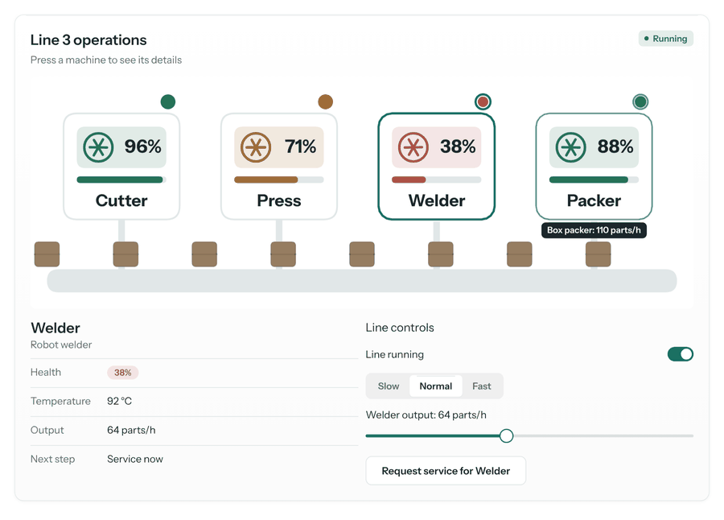
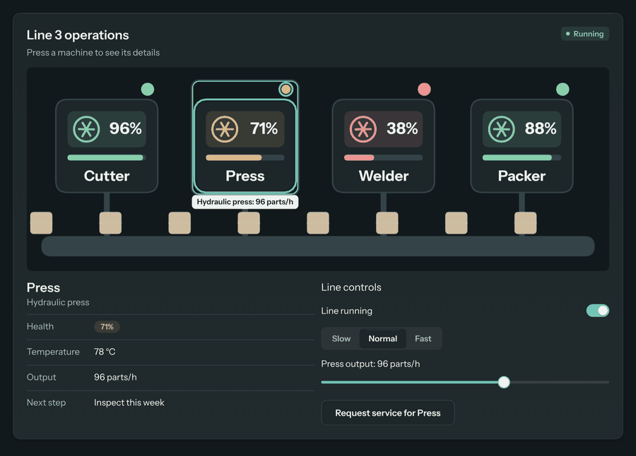
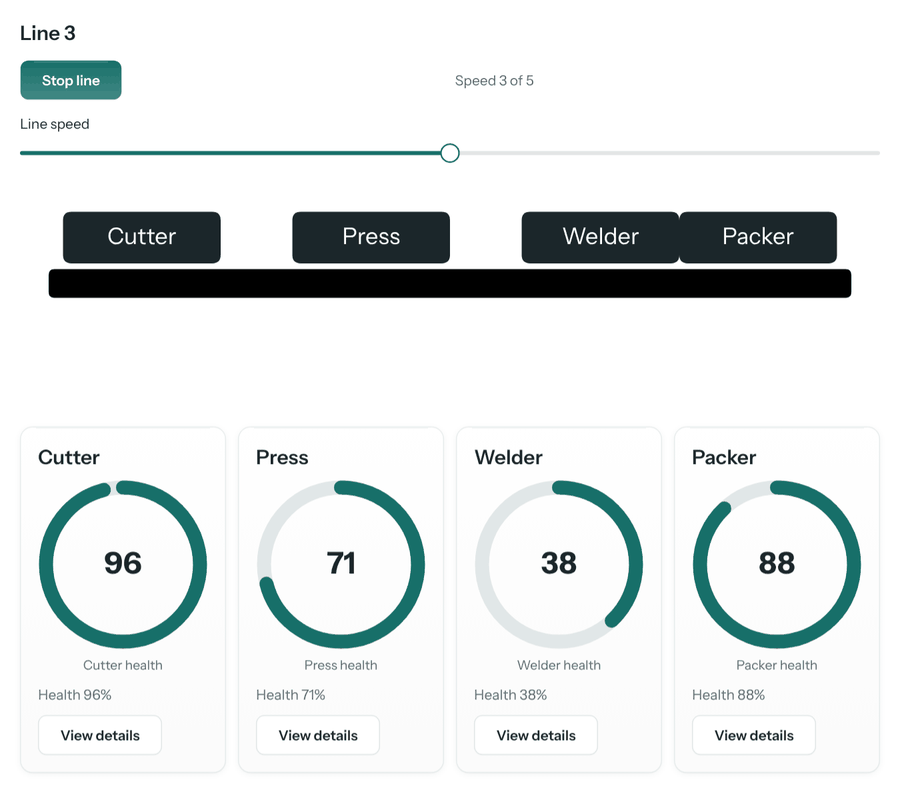
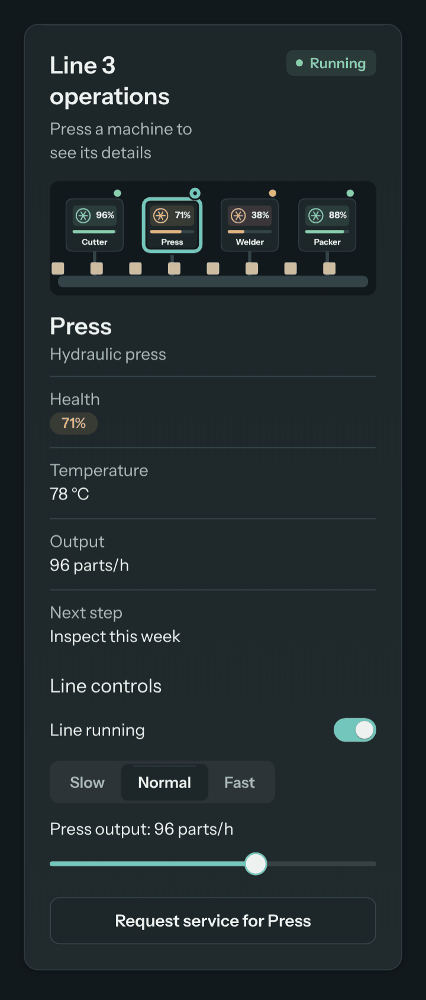

# Plan: interactive scenes

**Status:** interaction and the wider drawing check built (2026-11-07). Responsive composition and new drawing primitives deferred (see the gate).
**Scope:** experimental, opt-in `sayshape/scene` only. Nothing changes for specs without scenes.

This is the feasibility review written before any code changed, then what was built.

## What the code does today (read, not assumed)

| Area | What's there | What it means for interaction |
|---|---|---|
| Scene paint (`src/components/scene/index.ts`, `draw.ts`) | A scene lays out as one box (`h = w·sceneH/sceneW`), then each frame draws its lines itself with `translate(box.x, box.y)` and `scale(box.w/w, box.h/h)`, plus each group's or use's `translate`/`rotate`/`scale`, and each shape's own `rotate` around its center. Shapes have no boxes. | Shapes can't use the normal "one box per element" hit regions; the scene has to register them while it paints. |
| Scope | The base scope is `t`, `PI`, then `ctx.scope` (state and derived). `each` and `use args=` wrap it per copy. | **State binding already works.** `fill={sel == 'cutter' ? accent : line}` repaints when `sel` changes, because a state change re-runs layout and paint. Inputs outside a scene already update it. |
| Hit regions (`engine.ts`) | `ctx.addHit(box, {detail})` during paint; `targetAt` walks regions last-painted first; `ComponentDef.hitTest(box, x, y)` refines a hit; each region with a `detail` is its own Tab stop; `activate` → `press(ctx)` or `on=`. Regions are rebuilt every paint. | A scene can register one axis-aligned region per pressable shape, with a stable `detail`, and refine it exactly in `hitTest`. Regions follow animation for free, since they're rebuilt each frame. **Blocker:** `hitTest` isn't told which region was hit, so it can't look up that shape's exact geometry. |
| Actions (`actions.ts`, `engine.runActionString`) | Actions run with the pressed element's scope (`scopeOf(node)`), which knows `each` copies laid out by the engine. | **Blocker:** a scene draws its own `each` (shape copies aren't laid-out nodes), so `on=set:sel:{m.id}` inside a scene's `each` would not see `m`. `PressContext.run` needs an optional scope. |
| Accessibility (`a11y/`) | `semantics()` may return `parts`, matched to hit regions by `detail`; each part becomes its own node and Tab stop, with `selected`/`pressed` state. | Reusable as is: pressable shapes become parts of the scene's `img`. |
| Drawing check (`review.ts`) | Draws the scene at rest onto a measuring context that tracks the transform matrix, recording each mark's bounds and order; finds labels cut off, labels on labels, labels straddling a box, lines hidden under boxes. Warnings with line numbers; never throws. | The same pass can carry pressable regions, label colors and sizes, so new checks are cheap and deterministic. |
| Responsive | A scene is a fixed `w×h` drawing scaled uniformly to its box width. Layout never sees scene names. | Real recomposition would need layout to evaluate scene formulas with a viewport name. Checks at phone width are cheap. |

## The gate

| Improvement | Feasible today? | Existing capabilities to reuse | Required changes | Risks | Recommendation |
|---|---|---|---|---|---|
| Interactive scenes | **Yes** | `addHit` with `detail`, `hitTest`, `press`, Tab order from regions, focus ring, `semantics` `parts`, actions and state, `ctx.view`, scene scope | Two optional, backward-compatible engine hooks (`hitTest` gets the region's `detail`; `PressContext.run` takes an optional scope). Scene draw tracks its transform and records pressable shapes. New scene props `on=`, `tip=`, `selected=`, `name=`. | Hit geometry one frame behind a moving shape (16 ms); many pressable shapes = many Tab stops; a focus ring drawn as an upright box around a turned shape. | **Go**, scoped to press, hover, focus, selection and a tooltip. No dragging shapes, no per-shape hover formulas. |
| Visual self-correction | **Partial** | `review.ts` measuring context and mark list | Add: pressable shape too small to tap at phone width, pressable shapes on top of each other, pressable shape outside the picture, label unreadably small at phone width, label with low contrast against what's under it (light and dark). | False positives on art (a decorative label over a gradient). Contrast only where both colors are plain. | **Go** for those five. **No-go** for checks during animation (sampling frames mostly flags intended motion). |
| Responsive scenes | **Partial** | Uniform scaling; the new phone-width checks | Recomposition needs a viewport name visible to layout and paint, and makes specs longer. | Larger language change for an experimental element. | **Defer.** Ship the phone-width checks (text size, tap size) so models fix what breaks on phones. |
| Visual expression | **Partial** | Shapes, paths, two-stop gradients, groups, define/use, theme colors with fades, formulas of `t` | None needed for the factory monitor (built from existing shapes). | Adding styling props grows every scene spec and the guide. | **No new primitives now.** Interaction feedback (hover, focus, selection outline) is drawn by the engine, so models spend no tokens on it. Candidates later: a soft `glow`, multi-stop gradients. |

### The questions

1. **Without rewriting the canvas engine?** Yes. Two optional parameters on existing hooks; everything else is inside `src/components/scene/`.
2. **Reuse state and actions?** Yes. `on=` is the same action string as everywhere (`set:sel:{m.id}`, `toggle:running`, `emit:inspect:{m.id}`); `selected=` is a condition on state; bindings already work.
3. **Backward compatible?** Yes. Existing scenes have no `on=`, register no regions and draw the same pixels. Other components ignore the new `hitTest` argument and never pass a scope to `run`.
4. **Optional?** Yes. Scenes stay off unless `sceneComponents` is registered; inside a scene, a shape is pressable only with `on=`.
5. **Model tokens?** Only for interactive scenes: about 10–25 tokens per pressable element (`on=set:sel:{m.id} selected={sel == m.id} tip="{m.name}"`). Feedback is automatic. The full guide without scenes is unchanged (`test/fixtures/guide-full.txt`).
6. **Performance or memory?** A matrix multiply per group/use and a few numbers per pressable shape per frame; region maps are replaced every frame and keyed weakly by element. Measured in step 3.
7. **Accessibility?** Yes. Each pressable shape is a part of the scene's picture: a button with a name (its `name=`, else its words, else its tip), `pressed` from `selected=`, its tip as the description; a Tab stop; Enter and Space press it.
8. **Simpler solution?** Partly: a `row` of `button`s or a `segmented` beside a scene already selects things without shape interaction. That stays the right answer for few, simple choices; it can't make the drawing itself the control (click the machine), which is the point of the use case.
9. **Explicitly not built:** dragging shapes, keyboard arrow navigation between shapes in 2D, per-shape `hover` names in formulas, general overlays/tooltips outside the scene's box, animation-time drawing checks, responsive recomposition, new shape types, network access, any script.

## What was built

### Pressable shapes

Any shape, `group` or `use` in a scene takes:

| Prop | What it does |
|---|---|
| `on=` | Actions to run when it's pressed (click, tap, Enter or Space), like a button's `on=`. Makes it pressable and a Tab stop. Inside the scene's `each`, actions see the item (`on=set:sel:{m.id}`). |
| `selected=` | A condition: draws a selection outline and tells screen readers it's selected (`selected={sel == m.id}`). |
| `tip=` | Words shown in a small tag above it while it's hovered or focused; may hold `{formulas}`. |
| `name=` | What screen readers call it. Default: the words of the labels inside it, else its tip. |

A pressed `group` or `use` is pressed anywhere on its shapes. Hit testing is exact under the scene's scaling, groups' moves, turns and scales, and shapes' own turns: rectangles, circles, ovals, polygons and filled paths by their outline (nonzero, as the canvas fills), lines and unfilled paths within a few pixels, labels by their own box. Writes go where the item was drawn from (`each items=machines` → item 2 of `machines`), as `each` does, including `remove:m`; a drawing's `args` names can be read but not written. The last-drawn pressable shape under the pointer wins; a pressable shape inside a pressable group wins over the group.

Hover, keyboard focus and `selected=` are drawn by the engine in theme colors (an outline that follows the shape), so models write nothing for them, and they look the same in every scene. With reduced motion, the scene is the still it always was, and it stays pressable.

### Drawing check additions

All warnings, with the line to fix and how:

- a pressable shape smaller than 24 px both ways at phone width (`PHONE_WIDTH`, 328 px: a 360 px phone less the screen's padding);
- two pressable shapes drawn mostly on top of each other (a press can't tell them apart);
- a pressable shape outside the picture;
- a label smaller than 8 px at phone width;
- a label whose color is too close to what's under it (contrast under 3:1), checked in light and dark.

Contrast compares plain colors only: a label over a gradient, a see-through fill or a named CSS color isn't judged, and the same words drawn twice (a shadow) are judged by the copy on top. A label with no `fill` is black, so the check now reports it on the dark card behind a scene in dark mode; that's a real problem the old check missed (three older tests gained `fill=ink`).

### Engine changes (both optional, backward compatible)

- `ComponentDef.hitTest(box, x, y, detail?)`: the engine passes the region's `detail`.
- `PressContext.run(actions, scope?)`: an element that draws its own copies passes the copy's scope; the engine reads it before the element's own, and writes through a scene item (`toggle:m.on`) find the item in state by identity, as `each` items already do.

### Example

`playground/scene-samples.ts` (offered with `?scene=1`) has the factory operations monitor: a production line from one `define "machine"` used per machine, machines from a list in state, crates moving along the belt (seamless loop, speed from state), a status light that pulses when health is low, a details panel, and a run switch, a speed control and an output slider outside the scene that change it without a new spec. Light and dark, keyboard, screen reader and reduced motion all come from the engine.

Screenshots (Chrome, from the sample; not the visual-regression baselines):

| | |
|---|---|
|  |  |
| Light: Welder pressed and selected, the panel and controls follow it; Packer hovered, with its tip. | Dark: Tab and Enter; the engine's focus ring, the selection outline and the tip. |
|  |  |
| A model's first attempt (Haiku, compact guide): the drawing check reports the black labels on black boxes. | The same model after one repair round with those warnings. |

## Measurements (2026-11-07, Node, recording canvas)

**Model generation.** Three first attempts at the factory request from the generated guide only (Claude Sonnet with the full guide, Claude Haiku with the full and the compact guide; not GPT-4.1, which the project usually tests with, since no endpoint was available here): all three parsed with no errors, all made the four machines pressable with `on=set:sel:{…}` and `selected=`, all four reached by Tab, and every press changed the panel. The drawing check found real problems in all three (labels unreadable on a phone; black labels on black boxes in one), and one repair round with those warnings fixed every one. Specs were 436–633 tokens.

**Guide size.** Scene part of the full guide: 11,581 → 14,055 characters (about +620 tokens); compact: 2,764 → 3,151 (about +100). The guide without scenes is unchanged (`test/fixtures/guide-full.txt`).

**Frame cost** (`bench/scene.bench.ts`, means, noisy at ±5–15%, after the review fixes): the factory monitor paints in about 0.9–1.2 ms with its four pressable machines, one selected, against about 0.8–1.0 ms with nothing pressable; 200 pressable circles take about 1.2 ms against about 0.5 ms for 200 plain ones (about 3 µs per pressable shape: its outline, its region and its tip). Finding what's under the pointer among 200 pressable circles takes under 1 µs. Over 4,000 frames the heap grows about as much with pressable machines as without them (a few hundred KB, levelling off), so no per-frame leak shows. The core benchmarks (`bench/engine.bench.ts`) show no change beyond their noise.

## Independent review

A separate review of the first version found eight defects, all fixed with a test each (`test/scene-interact.test.ts`, "review findings"): chained writes to one scene item failing after the first, a write landing in another list holding the same item, `remove:m` not working, polygons hit with a different fill rule than they're painted with, paths hit by their box, focus jumping to another item when a list was reordered (now keyed by `key=`), the screen-reader mirror not following shapes that appear or move during an animation (the engine now rebuilds it when the set of regions changes, and at most every 250 ms while they only move), and the tap-size check measuring the wrong side and running slowly with deeply nested pressable groups. A pressable label on its own now gets its selection outline too.

## Limits and next steps

- The focus ring is the engine's upright box around a turned shape.
- Hit regions are the last painted frame's: on a fast-moving shape, a press lands where it was up to one frame ago.
- A scene's each items can be written to (`toggle:m.on`) only when they come from a list in state, as with `each`.
- Next, if wanted: arrow keys between pressable shapes; a soft `glow`; a `narrow` name for scenes that recompose on phones; checking a moving label against the edges at a few moments of its animation, for labels meant to stay put.
